# 🛡️ SecureVault: Full-Stack Password Vault & Credential Management System

> **Infosys Springboard Java Project — Team 3**  
> An enterprise-grade, encrypted credential management platform providing secure credential storage, multi-factor authentication, team vault collaboration, audit logging, and security analytics.


---

## 📌 Project Overview (Completed Work)

This repository currently implements **Milestone 1: Project Initialization, System Architecture & Database Foundation**:

* **Normalized Relational Schema (`database/schema.sql`)**: 20 tables covering authentication, PBKDF2/AES cryptographic metadata, vaults, secure credential sharing, security event logging, notifications, and analytics.
* **Automated Containerized Infrastructure (`docker-compose.yml`)**: Preconfigured, one-command deployment of **PostgreSQL 16**, **Redis 7** (caching layer), and **pgAdmin 4** (web management GUI).
* **Automated Database Bootstrapping**: Mounts the schema script directly into PostgreSQL’s initialization hook for zero-config table generation.
* **Pre-populated Seed Data**: Initialized system roles and default credential categories aligned with project specifications.

---

## 📊 Database Schema & Entity-Relationship Diagram

```mermaid
erDiagram
    %% ==========================================
    %% 1. USER AUTHENTICATION & ACCESS CONTROL
    %% ==========================================
    USERS ||--o{ USER_ROLES : has
    ROLES ||--o{ USER_ROLES : assigned_to
    USERS ||--o{ SESSIONS : manages
    USERS ||--o{ DEVICES : registers
    USERS ||--o{ NOTIFICATIONS : receives

    USERS {
        UUID id PK
        string username "NOT NULL UNIQUE"
        string email "NOT NULL UNIQUE"
        string password_hash "NOT NULL"
        string vault_key_salt "NOT NULL"
        boolean mfa_enabled "NOT NULL DEFAULT false"
        string mfa_secret "ENCRYPTED NULLABLE"
        string oauth2_provider "NULLABLE"
        string reset_password_token "NULLABLE"
        datetime reset_token_expires_at "NULLABLE"
        int failed_login_attempts "NOT NULL DEFAULT 0"
        datetime locked_until "NULLABLE"
        boolean is_active "NOT NULL DEFAULT true"
        datetime created_at "NOT NULL"
        datetime updated_at "NOT NULL"
    }

    ROLES {
        int id PK
        string role_name "NOT NULL UNIQUE"
    }

    USER_ROLES {
        UUID user_id PK, FK
        int role_id PK, FK
    }

    SESSIONS {
        UUID id PK
        UUID user_id FK "NOT NULL"
        string session_token "NOT NULL UNIQUE"
        string ip_address "NOT NULL"
        string user_agent "NULLABLE"
        boolean is_revoked "NOT NULL DEFAULT false"
        datetime expires_at "NOT NULL"
        datetime created_at "NOT NULL"
    }

    DEVICES {
        UUID id PK
        UUID user_id FK "NOT NULL"
        string device_name "NOT NULL"
        string device_fingerprint "NOT NULL"
        boolean is_trusted "NOT NULL DEFAULT false"
        datetime last_active "NOT NULL"
        datetime created_at "NOT NULL"
    }

    %% ==========================================
    %% 2. PASSWORD VAULT & CREDENTIAL MODULE
    %% ==========================================
    USERS ||--o{ VAULTS : owns
    VAULTS ||--o{ VAULT_MEMBERS : grants_membership
    USERS ||--o{ VAULT_MEMBERS : participates_in
    VAULTS ||--o{ FOLDERS : contains
    VAULTS ||--o{ CREDENTIALS : stores
    FOLDERS ||--o{ CREDENTIALS : organizes
    CATEGORIES ||--o{ CREDENTIALS : classifies
    CREDENTIALS ||--o{ TAG_MAPPINGS : tagged_with
    TAGS ||--o{ TAG_MAPPINGS : applies_to
    CREDENTIALS ||--o{ ATTACHMENTS : includes

    VAULTS {
        UUID id PK
        UUID owner_id FK "NOT NULL"
        string vault_name "NOT NULL"
        string vault_type "NOT NULL DEFAULT PERSONAL"
        datetime created_at "NOT NULL"
        datetime updated_at "NOT NULL"
    }

    VAULT_MEMBERS {
        UUID vault_id PK, FK
        UUID user_id PK, FK
        string role "NOT NULL DEFAULT MEMBER"
        datetime joined_at "NOT NULL"
    }

    FOLDERS {
        UUID id PK
        UUID vault_id FK "NOT NULL"
        string folder_name "NOT NULL"
        datetime created_at "NOT NULL"
    }

    CATEGORIES {
        int id PK
        string category_name "NOT NULL UNIQUE"
    }

    TAGS {
        int id PK
        string tag_name "NOT NULL UNIQUE"
    }

    TAG_MAPPINGS {
        UUID credential_id PK, FK
        int tag_id PK, FK
    }

    CREDENTIALS {
        UUID id PK
        UUID vault_id FK "NOT NULL"
        UUID folder_id FK "NULLABLE"
        int category_id FK "NOT NULL"
        string credential_type "NOT NULL"
        string title "NOT NULL"
        string website_url "NULLABLE"
        text encrypted_data "NOT NULL"
        string encryption_iv "NOT NULL"
        int key_version "NOT NULL DEFAULT 1"
        int strength_score "NULLABLE"
        boolean is_favorite "NOT NULL DEFAULT false"
        datetime last_used_at "NULLABLE"
        datetime created_at "NOT NULL"
        datetime updated_at "NOT NULL"
    }

    ATTACHMENTS {
        UUID id PK
        UUID credential_id FK "NOT NULL"
        string file_name "NOT NULL"
        int file_size_bytes "NOT NULL"
        string mime_type "NOT NULL"
        string s3_file_path "NOT NULL"
        string encryption_iv "NOT NULL"
        datetime uploaded_at "NOT NULL"
    }

    %% ==========================================
    %% 3. SECURE SHARING MODULE
    %% ==========================================
    USERS ||--o{ SHARING : initiates
    USERS ||--o{ SHARING : receives
    CREDENTIALS ||--o{ SHARING : shared_via

    SHARING {
        UUID id PK
        UUID credential_id FK "NOT NULL"
        UUID shared_by_user_id FK "NOT NULL"
        UUID shared_with_user_id FK "NOT NULL"
        string permission_level "NOT NULL"
        string status "NOT NULL DEFAULT ACTIVE"
        datetime expires_at "NULLABLE"
        datetime created_at "NOT NULL"
    }

    %% ==========================================
    %% 4. SECURITY MONITORING & AUDIT LOGGING
    %% ==========================================
    USERS ||--o{ AUDIT_LOGS : performs
    USERS ||--o{ SECURITY_EVENTS : triggers

    AUDIT_LOGS {
        UUID id PK
        UUID user_id FK "NULLABLE"
        string action_type "NOT NULL"
        string status "NOT NULL"
        string ip_address "NOT NULL"
        text details "NULLABLE"
        datetime timestamp "NOT NULL"
    }

    SECURITY_EVENTS {
        UUID id PK
        UUID user_id FK "NULLABLE"
        string event_type "NOT NULL"
        string severity "NOT NULL DEFAULT MEDIUM"
        int risk_score "NOT NULL"
        boolean anomaly_detected "NOT NULL"
        boolean is_resolved "NOT NULL DEFAULT false"
        string ip_address "NULLABLE"
        datetime timestamp "NOT NULL"
    }

    BLOCKED_IPS {
        string ip_address PK
        string reason "NOT NULL"
        datetime blocked_until "NOT NULL"
        datetime created_at "NOT NULL"
    }

    NOTIFICATIONS {
        UUID id PK
        UUID user_id FK "NOT NULL"
        string title "NOT NULL"
        text message "NOT NULL"
        string notification_type "NOT NULL"
        boolean is_read "NOT NULL DEFAULT false"
        datetime created_at "NOT NULL"
    }

    %% ==========================================
    %% 5. ANALYTICS DASHBOARD MODULE
    %% ==========================================
    USERS ||--|| PASSWORD_HEALTH : tracked_by

    PASSWORD_HEALTH {
        UUID user_id PK, FK
        int overall_health_score "NOT NULL"
        int weak_passwords_count "NOT NULL DEFAULT 0"
        int reused_passwords_count "NOT NULL DEFAULT 0"
        int compromised_count "NOT NULL DEFAULT 0"
        datetime last_calculated "NOT NULL"
    }

    LOGIN_STATS {
        date stat_date PK
        int total_logins "NOT NULL DEFAULT 0"
        int failed_logins "NOT NULL DEFAULT 0"
        int mfa_successes "NOT NULL DEFAULT 0"
    }
```



---

## 🛠️ Infrastructure & Service Architecture

The services are managed via `docker-compose.yml`:

| Service | Container Name | Image | Port | Credentials / Config |
| :--- | :--- | :--- | :--- | :--- |
| **PostgreSQL** | `securevault-postgres` | `postgres:16-alpine` | `5432:5432` | DB: `securevault_db`<br>User: `postgres`<br>Password: `postgrespassword` |
| **Redis** | `securevault-redis` | `redis:7-alpine` | `6379:6379` | Default Redis cache port |
| **pgAdmin** | `securevault-pgadmin` | `dpage/pgadmin4:latest` | `5050:80` | Web Login: `admin@securevault.com`<br>Password: `admin` |

---

## 🚀 How to Run the Project

### Prerequisites
* [Docker Desktop](https://www.docker.com/products/docker-desktop/) installed and running.
* [Git](https://git-scm.com/) installed.

---

### Step 1: Clone the Repository
```bash
git clone https://github.com/livingmangal/Infosys-Springboard-Java-Team3.git
cd Infosys-Springboard-Java-Team3
```

---

### Step 2: Start Containers with Docker Compose
Ensure Docker Desktop is open and run:
```bash
docker compose up -d
```
> **Note:** On first startup, Docker will pull the images and automatically execute `database/schema.sql`, creating all 20 tables and seeding default data.

---

### Step 3: Verify Running Services
Check that all three containers are healthy:
```bash
docker ps
```

To verify the tables directly inside PostgreSQL:
```bash
docker exec -it securevault-postgres psql -U postgres -d securevault_db -c "\dt"
```

---

### Step 4: Access pgAdmin (Web GUI)
1. Open your browser and navigate to: **`http://localhost:5050`**
2. Sign in with:
   * **Email:** `admin@securevault.com`
   * **Password:** `admin`
3. Connect to the database:
   * Right-click **Servers** ➔ **Register** ➔ **Server...**
   * **General Tab:** Name: `SecureVault`
   * **Connection Tab:**
     * **Host name/address:** `postgres` *(internal Docker network service name)*
     * **Port:** `5432`
     * **Maintenance database:** `securevault_db`
     * **Username:** `postgres`
     * **Password:** `postgrespassword`
   * Click **Save**.
4. Browse to **Servers** ➔ **SecureVault** ➔ **Databases** ➔ **securevault_db** ➔ **Schemas** ➔ **public** ➔ **Tables** to view and query tables interactively.

---

## 📂 Project Structure

```text
Infosys-Springboard-Java-Team3/
├── database/
│   └── schema.sql        # PostgreSQL DDL with extensions, tables, indexes, and seed data
├── docker-compose.yml     # Multi-container orchestration (PostgreSQL, Redis, pgAdmin)
├── schema.md              # Detailed schema design documentation & ER diagram
├── README.md              # Project setup, execution guide, and architecture
└── Java_Integrated Password Vault...pdf  # Project specifications and syllabus
```

---

## 📦 Database Tables Overview

| Module | Tables | Purpose |
| :--- | :--- | :--- |
| **Authentication & Access Control** | `users`, `roles`, `user_roles`, `sessions`, `devices` | User management, RBAC, session tokens, and trusted device tracking. |
| **Vault & Credential Storage** | `vaults`, `vault_members`, `folders`, `categories`, `credentials`, `tags`, `tag_mappings`, `attachments` | Hierarchical encrypted item storage, categories, and file attachments. |
| **Secure Sharing** | `sharing` | Granular item sharing with permission tiers and expiration dates. |
| **Security & Audit Monitoring** | `audit_logs`, `security_events`, `blocked_ips`, `notifications` | Immutable audit trails, anomaly risk scores, IP blocking, and user alerts. |
| **Analytics Dashboard** | `password_health`, `login_stats` | User security posture scoring and daily login telemetry. |

### Pre-seeded Data
* **User Roles:** `ROLE_USER`, `ROLE_TEAM_MEMBER`, `ROLE_ADMIN`
* **Credential Categories:** `Website Login`, `Email Accounts`, `Banking Credentials`, `Social Media Accounts`, `Application Accounts`, `API Keys`, `Secure Notes`

---

## 🛑 Stopping the Containers

To stop the containers without losing any database data:
```bash
docker compose down
```
*(Your data is preserved in the Docker persistent volumes `postgres_data` and `redis_data`)*.

---

## 🗺️ Roadmap & Next Steps

- [x] **Milestone 1:** Database Schema Design, Normalization & Docker Setup
- [ ] **Milestone 2:** Spring Boot Backend Initialization (Spring Security + JWT + Spring Data JPA)
- [ ] **Milestone 3:** Encryption Service (AES-256-GCM + PBKDF2 Key Derivation) & Credential CRUD APIs
- [ ] **Milestone 4:** Secure Sharing Service & Audit Logging Interceptors
- [ ] **Milestone 5:** React.js Frontend Integration & Dashboards
