# 🛡️ SecureVault — Database Schema & Architecture

> **Infosys Springboard Java Project — Team 3**  
> Integrated Password Vault & Secure Credential Sharing Management System  
> **Database:** PostgreSQL 16 | **Key Type:** UUID (`gen_random_uuid()`) | **Cache:** Redis 7

---

## 📊 Entity Relationship Diagram (ERD)

```mermaid
erDiagram
    %% ==========================================
    %% 1. USER AUTHENTICATION & ACCESS CONTROL
    %% ==========================================
    USERS ||--o{ USER_ROLES : has
    ROLES ||--o{ USER_ROLES : assigned_to
    USERS ||--o{ SESSIONS : manages
    USERS ||--o{ DEVICES : registers
    USERS ||--o{ NOTIFICATIONS : receives

    USERS {
        UUID id PK
        string username "NOT NULL UNIQUE"
        string email "NOT NULL UNIQUE"
        string password_hash "NOT NULL"
        string vault_key_salt "NOT NULL"
        boolean mfa_enabled "NOT NULL DEFAULT false"
        string mfa_secret "ENCRYPTED NULLABLE"
        string oauth2_provider "NULLABLE"
        string reset_password_token "NULLABLE"
        datetime reset_token_expires_at "NULLABLE"
        int failed_login_attempts "NOT NULL DEFAULT 0"
        datetime locked_until "NULLABLE"
        boolean is_active "NOT NULL DEFAULT true"
        datetime created_at "NOT NULL"
        datetime updated_at "NOT NULL"
    }

    ROLES {
        int id PK
        string role_name "NOT NULL UNIQUE"
    }

    USER_ROLES {
        UUID user_id PK, FK
        int role_id PK, FK
    }

    SESSIONS {
        UUID id PK
        UUID user_id FK "NOT NULL"
        string session_token "NOT NULL UNIQUE"
        string ip_address "NOT NULL"
        string user_agent "NULLABLE"
        boolean is_revoked "NOT NULL DEFAULT false"
        datetime expires_at "NOT NULL"
        datetime created_at "NOT NULL"
    }

    DEVICES {
        UUID id PK
        UUID user_id FK "NOT NULL"
        string device_name "NOT NULL"
        string device_fingerprint "NOT NULL"
        boolean is_trusted "NOT NULL DEFAULT false"
        datetime last_active "NOT NULL"
        datetime created_at "NOT NULL"
    }

    %% ==========================================
    %% 2. PASSWORD VAULT & CREDENTIAL MODULE
    %% ==========================================
    USERS ||--o{ VAULTS : owns
    VAULTS ||--o{ VAULT_MEMBERS : grants_membership
    USERS ||--o{ VAULT_MEMBERS : participates_in
    VAULTS ||--o{ FOLDERS : contains
    VAULTS ||--o{ CREDENTIALS : stores
    FOLDERS ||--o{ CREDENTIALS : organizes
    CATEGORIES ||--o{ CREDENTIALS : classifies
    CREDENTIALS ||--o{ TAG_MAPPINGS : tagged_with
    TAGS ||--o{ TAG_MAPPINGS : applies_to
    CREDENTIALS ||--o{ ATTACHMENTS : includes

    VAULTS {
        UUID id PK
        UUID owner_id FK "NOT NULL"
        string vault_name "NOT NULL"
        string vault_type "NOT NULL DEFAULT PERSONAL"
        datetime created_at "NOT NULL"
        datetime updated_at "NOT NULL"
    }

    VAULT_MEMBERS {
        UUID vault_id PK, FK
        UUID user_id PK, FK
        string role "NOT NULL DEFAULT MEMBER"
        datetime joined_at "NOT NULL"
    }

    FOLDERS {
        UUID id PK
        UUID vault_id FK "NOT NULL"
        string folder_name "NOT NULL"
        datetime created_at "NOT NULL"
    }

    CATEGORIES {
        int id PK
        string category_name "NOT NULL UNIQUE"
    }

    TAGS {
        int id PK
        string tag_name "NOT NULL UNIQUE"
    }

    TAG_MAPPINGS {
        UUID credential_id PK, FK
        int tag_id PK, FK
    }

    CREDENTIALS {
        UUID id PK
        UUID vault_id FK "NOT NULL"
        UUID folder_id FK "NULLABLE"
        int category_id FK "NOT NULL"
        string credential_type "NOT NULL"
        string title "NOT NULL"
        string website_url "NULLABLE"
        text encrypted_data "NOT NULL"
        string encryption_iv "NOT NULL"
        int key_version "NOT NULL DEFAULT 1"
        int strength_score "NULLABLE"
        boolean is_favorite "NOT NULL DEFAULT false"
        datetime last_used_at "NULLABLE"
        datetime created_at "NOT NULL"
        datetime updated_at "NOT NULL"
    }

    ATTACHMENTS {
        UUID id PK
        UUID credential_id FK "NOT NULL"
        string file_name "NOT NULL"
        int file_size_bytes "NOT NULL"
        string mime_type "NOT NULL"
        string s3_file_path "NOT NULL"
        string encryption_iv "NOT NULL"
        datetime uploaded_at "NOT NULL"
    }

    %% ==========================================
    %% 3. SECURE SHARING MODULE
    %% ==========================================
    USERS ||--o{ SHARING : initiates
    USERS ||--o{ SHARING : receives
    CREDENTIALS ||--o{ SHARING : shared_via

    SHARING {
        UUID id PK
        UUID credential_id FK "NOT NULL"
        UUID shared_by_user_id FK "NOT NULL"
        UUID shared_with_user_id FK "NOT NULL"
        string permission_level "NOT NULL"
        string status "NOT NULL DEFAULT ACTIVE"
        datetime expires_at "NULLABLE"
        datetime created_at "NOT NULL"
    }

    %% ==========================================
    %% 4. SECURITY MONITORING & AUDIT LOGGING
    %% ==========================================
    USERS ||--o{ AUDIT_LOGS : performs
    USERS ||--o{ SECURITY_EVENTS : triggers

    AUDIT_LOGS {
        UUID id PK
        UUID user_id FK "NULLABLE"
        string action_type "NOT NULL"
        string status "NOT NULL"
        string ip_address "NOT NULL"
        text details "NULLABLE"
        datetime timestamp "NOT NULL"
    }

    SECURITY_EVENTS {
        UUID id PK
        UUID user_id FK "NULLABLE"
        string event_type "NOT NULL"
        string severity "NOT NULL DEFAULT MEDIUM"
        int risk_score "NOT NULL"
        boolean anomaly_detected "NOT NULL"
        boolean is_resolved "NOT NULL DEFAULT false"
        string ip_address "NULLABLE"
        datetime timestamp "NOT NULL"
    }

    BLOCKED_IPS {
        string ip_address PK
        string reason "NOT NULL"
        datetime blocked_until "NOT NULL"
        datetime created_at "NOT NULL"
    }

    NOTIFICATIONS {
        UUID id PK
        UUID user_id FK "NOT NULL"
        string title "NOT NULL"
        text message "NOT NULL"
        string notification_type "NOT NULL"
        boolean is_read "NOT NULL DEFAULT false"
        datetime created_at "NOT NULL"
    }

    %% ==========================================
    %% 5. ANALYTICS DASHBOARD MODULE
    %% ==========================================
    USERS ||--|| PASSWORD_HEALTH : tracked_by

    PASSWORD_HEALTH {
        UUID user_id PK, FK
        int overall_health_score "NOT NULL"
        int weak_passwords_count "NOT NULL DEFAULT 0"
        int reused_passwords_count "NOT NULL DEFAULT 0"
        int compromised_count "NOT NULL DEFAULT 0"
        datetime last_calculated "NOT NULL"
    }

    LOGIN_STATS {
        date stat_date PK
        int total_logins "NOT NULL DEFAULT 0"
        int failed_logins "NOT NULL DEFAULT 0"
        int mfa_successes "NOT NULL DEFAULT 0"
    }
```

---

## 📁 Modules Breakdown

### 1. User Authentication & Access Control
* **`users`**: Core user entity storing authentication hashes, salt for PBKDF2/Argon2 vault key derivation, MFA TOTP secrets, reset tokens, and account lockout tracking.
* **`roles` & `user_roles`**: Many-to-many RBAC model (`ROLE_USER`, `ROLE_TEAM_MEMBER`, `ROLE_ADMIN`).
* **`sessions`**: Active JWT/session tokens with IP, user-agent, expiry, and revocation tracking.
* **`devices`**: Device fingerprints for unfamiliar login detection and MFA device trust.

### 2. Password Vault & Credential Storage
* **`vaults`**: Personal and team vaults owned by users.
* **`vault_members`**: Membership and role delegation for shared team vaults.
* **`folders`**: Hierarchical organization inside vaults.
* **`categories`**: Default classifications (Website Login, Email Accounts, Banking Credentials, API Keys, etc.).
* **`credentials`**: Encrypted payload storage with AES-256-GCM metadata (`encryption_iv`, `key_version`), search titles, and strength scores.
* **`tags` & `tag_mappings`**: Flexible tagging system for credentials.
* **`attachments`**: Secure file attachments referencing encrypted S3 object paths.

### 3. Secure Sharing
* **`sharing`**: Granular credential sharing between users with permission levels (`VIEW`, `EDIT`, `FULL_MANAGEMENT`), status tracking (`ACTIVE`, `REVOKED`, `EXPIRED`), and expiration timestamps.

### 4. Security Monitoring, Audit Logging & Alerts
* **`audit_logs`**: Immutable audit trail for every user action, status (`SUCCESS`/`FAILURE`), IP address, and payload details.
* **`security_events`**: Anomaly and threat tracking with risk scores (`0-100`) and severity levels (`LOW`, `MEDIUM`, `HIGH`, `CRITICAL`).
* **`blocked_ips`**: IP throttling and brute-force blocklist.
* **`notifications`**: User alert queue for login notifications, security warnings, and share invites.

### 5. Analytics Dashboard
* **`password_health`**: Aggregated security score per user, counting weak, reused, and compromised passwords.
* **`login_stats`**: Daily metrics tracking total logins, failures, and MFA successes for admin dashboards.
